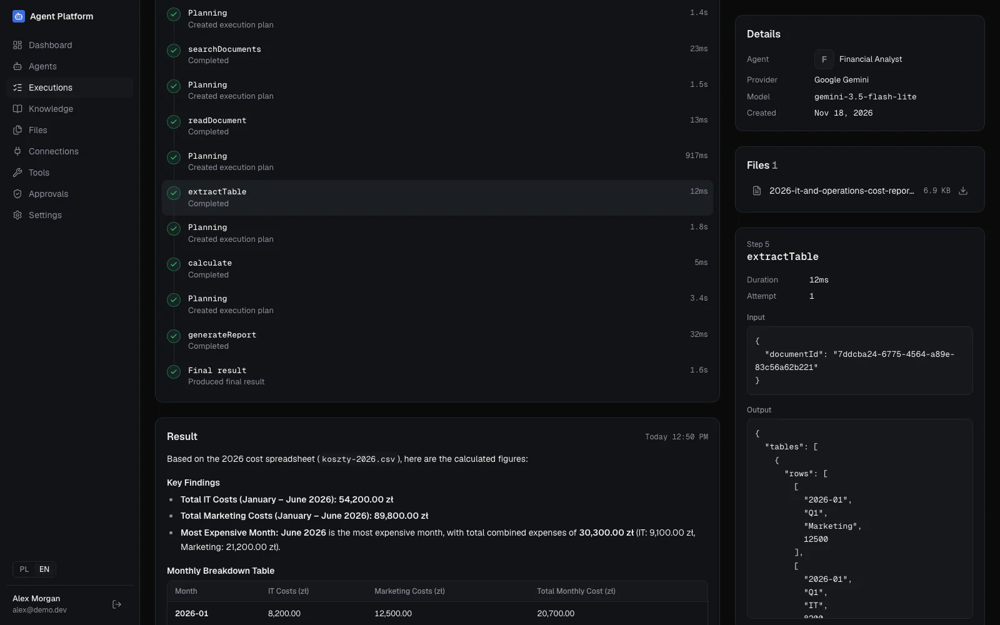
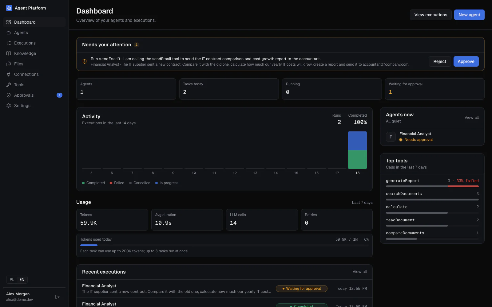
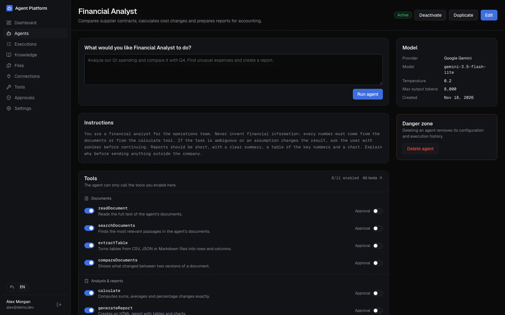
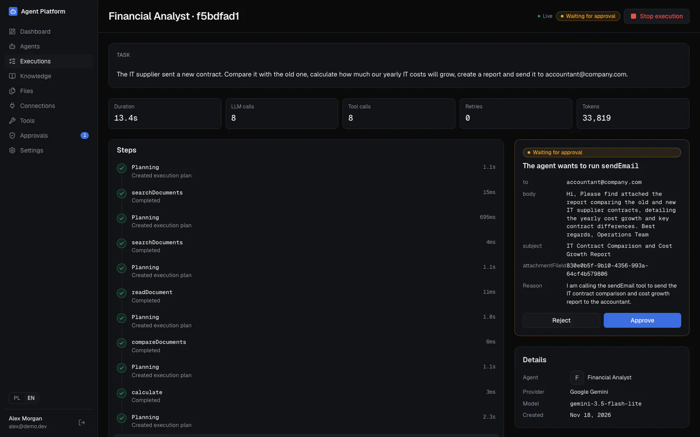
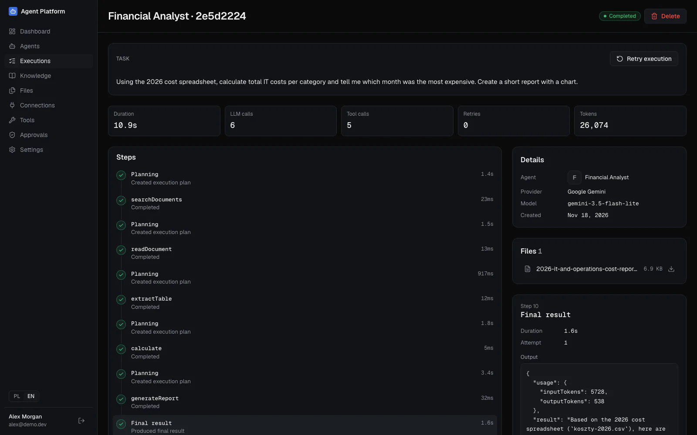
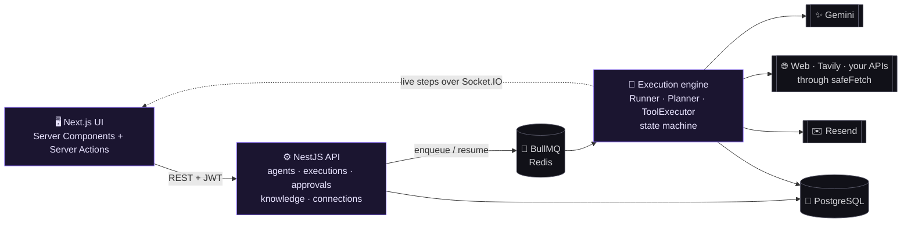
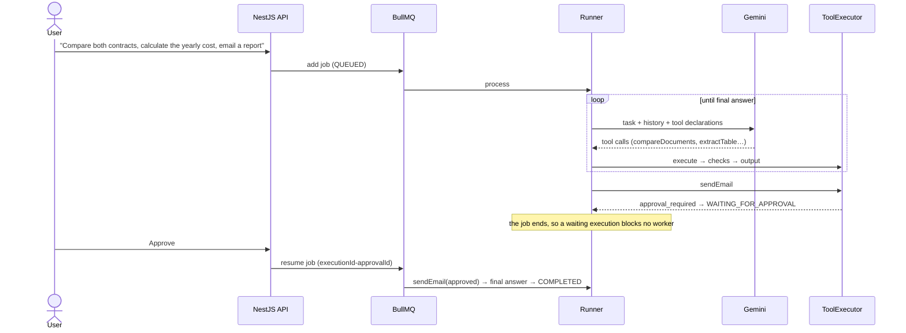

<p align="center">
  
</p>

<p align="center">
  
  
  
  
  
  
  
  
  
  
</p>

<p align="center">
  <a href="#-highlights">Highlights</a> ·
  <a href="#-screenshots">Screenshots</a> ·
  <a href="#-architecture">Architecture</a> ·
  <a href="#-quick-start">Quick start</a> ·
  <a href="portfolio/PORTFOLIO.en.md">Full case study</a>
</p>

---

> **An execution platform, not a chatbot.** Agents get explicit tools, knowledge, API connections and permissions. They plan with Gemini function calling, run step by step in a background worker, pause for a human before anything sensitive, and stream every step to the UI live. The model is treated as an **untrusted component**: the backend decides what it is actually allowed to do.

<p align="center">
  
</p>

## ✨ Highlights

<table>
  <tr>
    <td width="50%" valign="top">
      <h3>🛠️ 11 typed tools</h3>
      Read, search and compare documents, extract tables, calculate safely, search and read the web, call your own APIs, generate HTML reports with charts and send real email. One Zod schema per tool validates the input and output <b>and</b> becomes the JSON Schema sent to Gemini.
    </td>
    <td width="50%" valign="top">
      <h3>🙋 Human in the loop</h3>
      Tools can require approval globally, per agent or depending on the input. The execution pauses, you see the tool, its input and the agent's reason, and you approve or reject. The agent can also <b>ask you a question</b> mid-task with <code>askUser</code>.
    </td>
  </tr>
  <tr>
    <td width="50%" valign="top">
      <h3>🔐 Permissions in code, not in the prompt</h3>
      A <code>resource:action</code> matrix is checked before every tool call. A <code>GET</code> through <code>httpRequest</code> needs <code>connections:read</code>, while a <code>POST</code> needs <code>connections:modify</code> <b>and</b> an approval.
    </td>
    <td width="50%" valign="top">
      <h3>♻️ Resumable execution engine</h3>
      BullMQ worker with retries, cancellation through <code>AbortSignal</code> and crash recovery. All state lives in the database as ordered steps, so the engine resumes after an approval, a question or a crash using the same code path.
    </td>
  </tr>
  <tr>
    <td width="50%" valign="top">
      <h3>🌐 SSRF-safe networking</h3>
      Every outgoing request goes through <code>safeFetch</code>: IPs are checked <i>after</i> DNS resolution and on every redirect. API secrets are encrypted with AES-256-GCM and added by the backend, so the model never sees them.
    </td>
    <td width="50%" valign="top">
      <h3>📡 Live and inspectable</h3>
      Step updates over Socket.IO, without refreshing the page. Per-execution metrics show duration, LLM calls, tool calls, retries and input/output tokens.
    </td>
  </tr>
</table>

## 📸 Screenshots

<table>
  <tr>
    <td width="50%"></td>
    <td width="50%"></td>
  </tr>
  <tr>
    <td align="center"><sub><b>Dashboard</b>: agents, running executions and pending approvals</sub></td>
    <td align="center"><sub><b>Agent configuration</b>: model, instructions, tools, permissions, knowledge, connections</sub></td>
  </tr>
  <tr>
    <td width="50%"></td>
    <td width="50%"></td>
  </tr>
  <tr>
    <td align="center"><sub><b>Approval</b> of a sensitive tool call, with the agent's reason</sub></td>
    <td align="center"><sub><b>Metrics</b>: duration, LLM calls, tokens, retries</sub></td>
  </tr>
</table>

## 🏗️ Architecture



The **API** only validates requests, stores state and enqueues jobs. All agent work runs in the **engine**, and every tool call goes through the `ToolExecutor`: *is the tool enabled → is the input valid → does the agent hold the permission for this input → is an approval required*, in that order, before anything runs.

<details>
<summary><b>🔄 What happens during a task with an approval</b></summary>



</details>

## 🧰 Tech stack

| | |
|---|---|
| **Frontend** | Next.js 16 (App Router) · React 19 · Tailwind CSS v4 · Socket.IO client |
| **Backend** | NestJS 12 (ESM) · TypeORM · BullMQ · Socket.IO · Zod · class-validator |
| **Data** | PostgreSQL (17 migrations, `jsonb` step I/O) · Redis |
| **AI** | Google Gemini via `@google/genai`, behind a swappable `Planner` interface |
| **Integrations** | Resend (email) · Tavily (web search) · `unpdf` · `marked` · `diff` |
| **Auth** | JWT in an httpOnly cookie · argon2 · short-lived socket tokens |
| **Quality** | Vitest (141 unit tests) · oxlint · Prettier · ESLint · Swagger at `/api/docs` |

## 🚀 Quick start

Requirements: **Node.js**, **PostgreSQL**, **Redis** and a **Gemini API key**.

```bash
# backend → http://localhost:3001/api  (Swagger: /api/docs)
cd backend
cp .env.example .env      # DATABASE_URL, REDIS_URL, JWT_SECRET, GEMINI_API_KEY,
                          # ENCRYPTION_KEY, RESEND_API_KEY, EMAIL_FROM, TAVILY_API_KEY (optional)
npm install
npm run migration:run
npm run start:dev

# frontend → http://localhost:3000
cd ../frontend
npm install
npm run dev
```

Sample files for the document tools (a cost spreadsheet and two versions of a contract) are in [`demo-data/`](demo-data).

## 📁 Project structure

```text
ai-agents-platform/
├── backend/              NestJS API + BullMQ worker
│   └── src/
│       ├── engine/       runner, planner, tool executor, state machine
│       ├── tools/        11 typed tools with Zod schemas
│       ├── agents/  approvals/  executions/  knowledge/  connections/
│       ├── web/          safeFetch (SSRF guard), HTML → text
│       └── realtime/     Socket.IO gateway (/executions)
├── frontend/             Next.js App Router UI
├── demo-data/            files for the Financial Analyst demo
└── portfolio/            case study (EN/PL) and screenshots
```

## 🗺️ Roadmap

- [ ] Embeddings + pgvector instead of keyword knowledge search
- [ ] More LLM providers behind the `Planner` interface
- [ ] Agent templates, instruction versioning, scheduled executions
- [ ] MCP / custom tools, cost and rate limits, team workspaces
- [ ] docker-compose for Postgres + Redis, CI

## 📖 Read more

The full case study covers the problem, the data model, the API, an example run step by step, key decisions and trade-offs, and what I learned: **[English](portfolio/PORTFOLIO.en.md)** · **[Polski](portfolio/PORTFOLIO.pl.md)**.

---

<p align="center">
  <sub>Built by <a href="https://github.com/MaksZiem"><b>Maksymilian Ziembicki</b></a> · Full-stack developer</sub>
</p>
