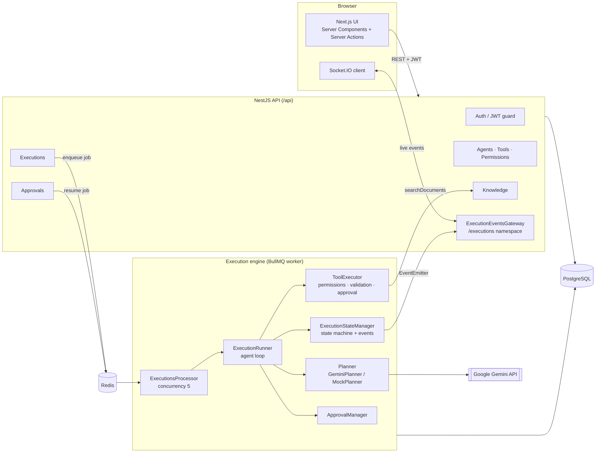
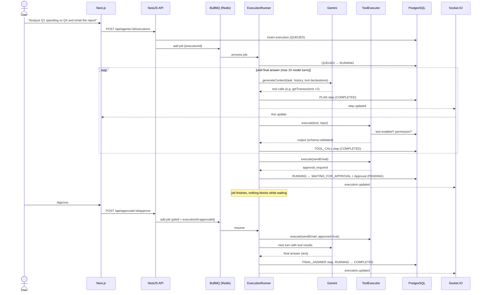
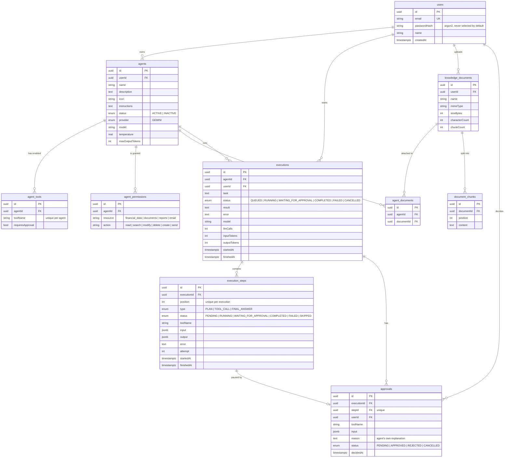

# AI Agent Platform

## Overview

AI Agent Platform is a full-stack SaaS-style application for creating AI agents, giving them explicit tools, knowledge and permissions, and delegating multi-step tasks to them. The agent plans its work with Gemini function calling, executes tools step by step in a background worker, pauses for human approval before sensitive actions, and streams every step to the UI live. Every execution is persisted and can be inspected afterwards.

It is deliberately **an execution platform, not a chatbot**: the model is treated as an untrusted component, and the backend decides what it is actually allowed to do.

## Problem

Most "AI agent" demos are a chat window with a prompt. That breaks down as soon as an agent needs to do real work:

- **Safety:** an LLM can decide to call any tool it sees. Permissions written in a prompt are not permissions.
- **Reliability:** model calls time out, hit rate limits or return malformed output. Processes crash mid-task.
- **Visibility:** users and developers cannot see what the agent did, why, or what it cost.
- **Control:** sensitive actions (sending an email, changing data) need a human decision, and execution must wait for it, sometimes for hours.

The platform solves these with backend-enforced permissions, a persistent and resumable execution engine on a job queue, human-in-the-loop approvals, and a live, inspectable execution timeline.

**Who it is for:** developers who want to see every step in detail (inputs, outputs, tokens, retries) and analysts or small teams who just delegate a task, approve actions and read the result.

## Key features

- **Agent management:** create, edit, duplicate, activate/deactivate and delete agents. Configure the model, temperature, max output tokens and system instructions.
- **Tool registry:** typed tools with Zod input/output schemas: `getTransactions`, `analyzeTransactions`, `comparePeriods`, `generateReport`, `searchDocuments`, `sendEmail`.
- **Per-agent permissions:** a resource/action matrix (`financial_data:read`, `documents:search`, `email:send` …) checked by the backend before every tool call.
- **Human-in-the-loop approvals:** tools can require approval globally or per agent. Execution pauses, the user sees the tool, its input and the agent's own reason, and approves or rejects.
- **Autonomous planning:** the agent decides which tools to call, in parallel when possible, and when to give the final answer.
- **Live execution UI:** step updates pushed over WebSockets (Socket.IO), so the page never needs a manual refresh.
- **Retries and failure handling:** retryable and permanent errors are told apart, retries use a growing delay, and attempts are visible ("Attempt 2 / 3").
- **Cancellation:** cancelling a running execution stops new steps from starting.
- **Crash recovery:** if a worker dies mid-execution, BullMQ re-delivers the job and the engine resumes from persisted steps.
- **Knowledge base (simple RAG):** upload `.pdf`, `.txt`, `.md`, `.csv` and `.json` files, extract their text, chunk it, attach documents to agents and search them with keyword scoring.
- **Observability:** per-execution metrics for duration, LLM calls, tool calls, retries, failed steps, approval requests and input/output tokens.
- **Dashboard:** agent count, today's tasks, running executions, pending approvals and recent executions.

## Tech stack

| Layer | Technology | Why |
|---|---|---|
| Frontend | Next.js 16 (App Router), React 19, Tailwind v4 | Server Components and Server Actions keep the JWT in an httpOnly cookie, so the browser never handles the API token directly |
| Realtime | Socket.IO (`/executions` namespace) | Room per execution, JWT handshake, simple reconnects |
| Backend | NestJS 12 (ESM, TypeScript) | Modules and DI map cleanly onto the domain: agents, tools, engine, approvals, knowledge |
| ORM / DB | TypeORM + PostgreSQL | Relational model, `jsonb` for step input/output, migrations only (`synchronize: false`) |
| Queue | BullMQ + Redis | Durable jobs, re-delivery after a crash, concurrency control, idempotent job IDs |
| LLM | Google Gemini via `@google/genai` | Native function calling. The `Planner` abstraction keeps the provider swappable |
| Validation | Zod (tools), class-validator (HTTP DTOs) | One Zod schema validates tool input/output **and** produces the JSON Schema sent to Gemini |
| Auth | JWT + argon2 | Stateless API auth, plus a separate short-lived token for WebSockets |
| Tests / lint | Vitest, oxlint, Prettier | Fast ESM-native test runner and linter |

## Architecture



The **API layer** only validates requests, stores state and enqueues jobs. All agent work happens in the **engine**, which runs in a BullMQ worker. The engine never trusts the model: every tool call goes through the `ToolExecutor`, which checks that the tool is enabled for the agent, that the agent holds the required permission, that the input matches the schema, and whether approval is required.

## Data flow: a task with an approval



Execution state lives **entirely in the database** as an ordered list of steps. The runner rebuilds the model conversation from those steps on every turn, which is why a paused or crashed execution can resume from exactly where it stopped.

## Database schema



The schema is managed through 12 incremental TypeORM migrations. Execution status transitions are guarded by an explicit state machine (`execution-status.ts`) and written with an optimistic `UPDATE … WHERE status = <expected>`, so two workers can never both move the same execution forward.

## API highlights

All routes are under `/api` and require a JWT unless marked public.

| Method | Route | Purpose |
|---|---|---|
| `POST` | `/auth/register`, `/auth/login` | Account creation and login |
| `POST` | `/auth/socket-token` | Short-lived (60 s) token for the WebSocket handshake |
| `GET/POST/PATCH/DELETE` | `/agents`, `/agents/:id` | Agent CRUD |
| `POST` | `/agents/:id/duplicate` | Clone an agent with its configuration |
| `PUT/DELETE` | `/agents/:agentId/tools/:toolName` | Enable or disable a tool, optionally with approval |
| `PUT` | `/agents/:agentId/permissions` | Replace the agent's permission set |
| `PUT/DELETE` | `/agents/:agentId/knowledge/:documentId` | Attach or detach a document |
| `POST` | `/agents/:agentId/executions` | Start a task |
| `GET` | `/executions/:id` | Execution with steps and computed metrics |
| `POST` | `/executions/:id/cancel` | Cancel a running execution |
| `POST` | `/approvals/:id/approve`, `/approvals/:id/reject` | Human decision, which resumes the execution |
| `POST` | `/knowledge` | Upload a document (multipart) |
| `GET` | `/dashboard` | Aggregated dashboard stats |
| `GET` | `/health` | Postgres + Redis health check |

**Example: starting a task**

```http
POST /api/agents/3f1c…/executions
Authorization: Bearer <jwt>
Content-Type: application/json

{ "task": "Analyze Q1 spending, compare it with Q4 and email the report to accountant@company.com" }
```

```json
{
  "id": "9b2e…",
  "agentId": "3f1c…",
  "task": "Analyze Q1 spending, compare it with Q4 and email the report to accountant@company.com",
  "status": "QUEUED",
  "model": "gemini-2.5-flash",
  "llmCalls": 0,
  "inputTokens": 0,
  "outputTokens": 0,
  "createdAt": "2026-10-12T14:32:05.120Z"
}
```

**WebSocket events** (namespace `/executions`): the client emits `subscribe` with an execution id, and the server checks ownership and then pushes `execution.updated` and `step.updated` events.

## Example run

The demo agent is a **Financial Analyst** with all finance tools enabled, `sendEmail` set to require approval, and permissions `financial_data:read`, `reports:create`, `documents:search` and `email:send`.

1. **Create the agent** with instructions like *"You are a financial analyst. Never invent financial information…"*, then pick the tools and permissions. *(screenshot: agent-config.png)*
2. **Start a task:** *"Analyze our Q1 spending and compare it with Q4. Find unusual expenses, create a report and send it to accountant@company.com."*
3. **Turn 1 (PLAN):** Gemini calls `getTransactions` twice in parallel (Q4 and Q1 ranges).
4. **Tool steps:** both calls pass the permission check and schema validation and return mock transaction data. Each step appears in the timeline live, with its input and output JSON. *(screenshot: execution-live.png)*
5. **Turn 2:** the model calls `analyzeTransactions` and `comparePeriods`, then `generateReport`.
6. **Turn 3:** the model calls `sendEmail` and explains why in one sentence. The executor returns `approval_required`, and the execution moves to **WAITING_FOR_APPROVAL**. The pending approval shows on the dashboard and on the Approvals page.
7. **Approve:** the user sees the recipient, subject, body and the agent's reason, then clicks *Approve*. *(screenshot: approval.png)*
8. **Resume:** a new job runs the approved tool, the model receives the result and writes the final answer, and the execution becomes **COMPLETED**.
9. **Inspect:** the metrics panel shows duration, LLM calls, tool calls, retries and tokens. *(screenshot: execution-metrics.png)*

If the user clicks *Reject* instead, the step is marked `SKIPPED`, the model is told "The user rejected this action." and adapts its answer.

## Key decisions & trade-offs

- **Steps as the single source of truth.** No in-memory agent state: the conversation is rebuilt from `execution_steps` on each turn. This costs an extra query per turn, but resume after approval, after a crash and after cancellation all use the same code path.
- **Waiting for approval doesn't block a worker.** The job finishes when approval is required, and a new job (with a deterministic `jobId = executionId-approvalId`) resumes it. Executions can wait for hours at zero cost.
- **Permissions enforced in code, never in the prompt.** `ToolExecutor` checks the enabled tool, then the resource:action permission, then the Zod input, then approval, in that order, before anything runs.
- **One schema, three uses.** A Zod schema per tool validates the model's input, validates the tool's output, and is converted to JSON Schema (`openapi-3.0` target) for Gemini's function declarations.
- **Retryable vs permanent errors.** `ModelCallError` and `ToolExecutionError` carry a `retryable` flag. A 429 with a short `retryDelay` is retried; a daily quota error is not. A failed tool call is **not fatal**: the model sees the error and can fix its input.
- **`Planner` as an abstract class.** It works as a Nest DI token. `GeminiPlanner` and the deterministic `MockPlanner` are interchangeable, which makes development without an API key possible.
- **Simple keyword RAG first.** Chunking (1000 characters, 150 overlap, cut at paragraph/sentence boundaries) plus term-frequency scoring behind a stable interface. Embeddings can replace the scorer without changing callers.

## Challenges & solutions

- **Resuming a model conversation after a pause.** Gemini needs its own previous message, including *thought signatures*, replayed exactly. Solution: store the provider's raw `Content` in the PLAN step output and replay it verbatim. Tool results from one turn go back together as a single `user` message of `functionResponse` parts.
- **Race conditions between cancel, approve and the worker.** Every status change is a conditional update (`WHERE id = ? AND status = ?`) validated against an allowed-transitions table. The runner checks `isStillRunning` before each step and after each retry delay, so a cancel always wins and is never overwritten.
- **Worker crash mid-execution.** When BullMQ re-delivers a job for an execution still marked `RUNNING`, the runner marks interrupted steps as failed and lets the model decide how to continue, instead of re-running side effects blindly.
- **Prompt injection through tool output.** The system instruction explicitly treats tool results as data, and since sensitive tools need both a permission and an approval, a malicious document cannot make the agent send an email on its own.
- **Live updates without leaking data.** WebSocket clients authenticate with a separate 60-second socket token, and `subscribe` verifies that the execution belongs to the user before joining the room.

## Testing & quality

- **Unit tests (Vitest):** `ToolExecutor` (permission, enablement, validation and approval paths), finance tools, execution metrics, chunking, knowledge search scoring, and the `withTimeout` helper.
- **Linting/formatting:** oxlint and Prettier on the backend, ESLint on the frontend.
- **Strict TypeScript** across both apps, with DTO validation (`whitelist`, `forbidNonWhitelisted`) on every HTTP request.
- <!-- TODO: add CI (GitHub Actions) and e2e tests if/when they exist -->

## Security

- Passwords hashed with **argon2**; `passwordHash` is excluded from queries and serialization.
- **JWT** guard on every route by default, with a `@Public()` opt-out for auth endpoints.
- Frontend stores the token in an **httpOnly, sameSite=lax cookie**; API calls run server-side in Server Actions.
- **Ownership scoping:** every query filters by `userId`, and tools receive a `ToolContext` scoped to one agent, so a tool can never read another agent's documents.
- **Backend-enforced tool permissions and approvals**; the LLM is treated as untrusted.
- No arbitrary code execution: tools are a fixed, typed registry.
- Secrets (Gemini key, DB credentials) never enter prompts.

## Running locally

Requirements: Node.js, PostgreSQL and Redis.

```bash
# backend
cd backend
cp .env.example .env          # set DATABASE_URL, REDIS_URL, JWT_SECRET, GEMINI_API_KEY
npm install
npm run migration:run
npm run start:dev             # http://localhost:3001/api

# frontend
cd ../frontend
npm install
npm run dev                   # http://localhost:3000
```

<!-- TODO: add docker-compose for Postgres + Redis to make this one command -->

## Limitations & roadmap

- Tools are deterministic mocks with synthetic financial data; `sendEmail` does not really send email.
- Knowledge search is keyword-based. Next step: embeddings + pgvector.
- Only Gemini is supported today; the `Planner` interface is ready for more providers.
- Planned: agent templates, instruction versioning, scheduled executions, MCP / custom tools, cost and rate limits, team workspaces.

## What I learned

- Designing a **resumable agent loop** where all state is persisted, rather than holding the conversation in memory.
- Building a **state machine with optimistic concurrency** that stays correct under parallel workers, cancels and approvals.
- Working with **LLM function calling** in practice: parallel tool calls, thought signatures, malformed calls, rate-limit handling.
- Treating the model as an **untrusted actor** and putting the security boundary in the backend.
- Wiring **BullMQ + Socket.IO + Next.js Server Components** into a live UI without client-side polling.
