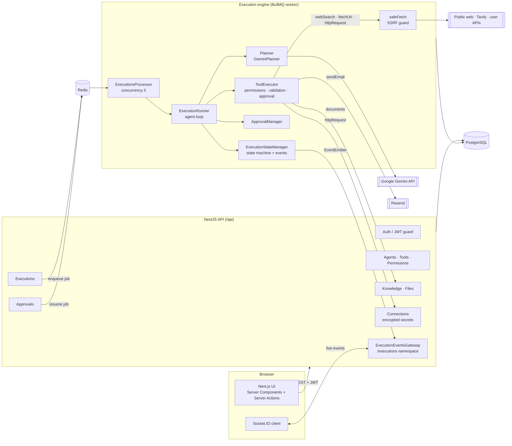
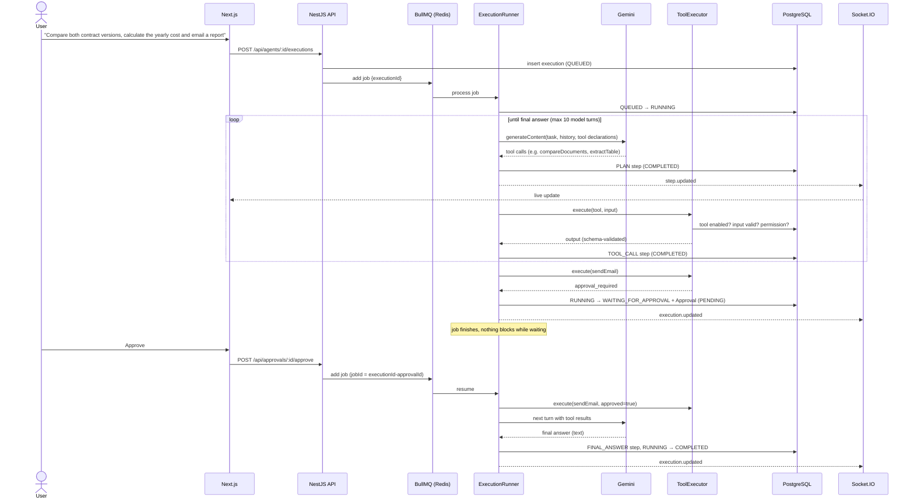
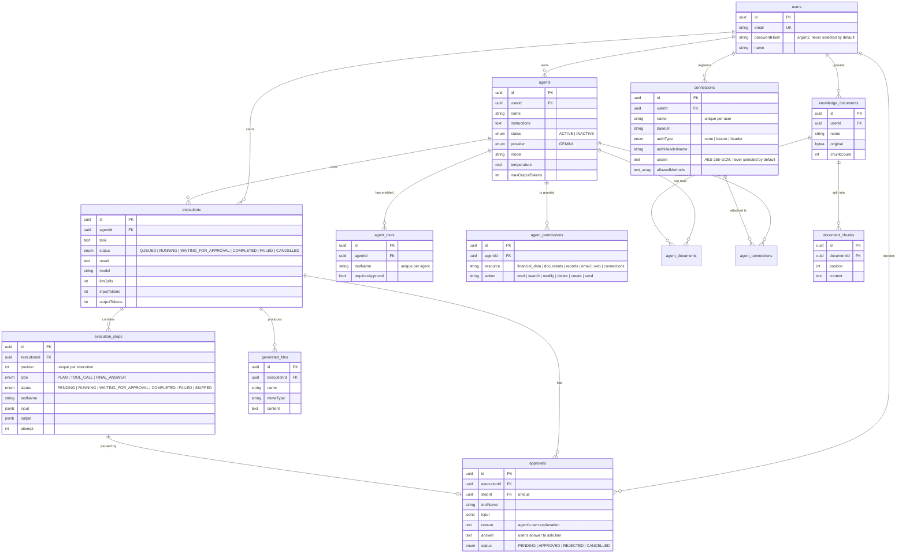

# AI Agent Platform

## Overview

AI Agent Platform is a full-stack SaaS-style application for creating AI agents, giving them explicit tools, knowledge, API connections and permissions, and delegating multi-step tasks to them. The agent plans its work with Gemini function calling and executes tools step by step in a background worker. It can read and compare documents, extract tables, calculate, search and read the web, call connected APIs, generate HTML reports with charts and send real email. It pauses for human approval before sensitive actions, can ask the user a question mid-task, and streams every step to the UI live. Every execution is persisted and can be inspected afterwards.

It is deliberately **an execution platform, not a chatbot**: the model is treated as an untrusted component, and the backend decides what it is actually allowed to do.

## Problem

Most "AI agent" demos are a chat window with a prompt. That breaks down as soon as an agent needs to do real work:

- **Safety:** an LLM can decide to call any tool it sees. Permissions written in a prompt are not permissions. Once an agent can fetch URLs and call APIs, it can also be tricked into reaching internal services or leaking credentials.
- **Reliability:** model calls time out, hit rate limits or return malformed output. Processes crash mid-task.
- **Visibility:** users and developers cannot see what the agent did, why, or what it cost.
- **Control:** sensitive actions (sending an email, writing to an external API) need a human decision, and execution must wait for it, sometimes for hours. Ambiguous tasks need a way for the agent to ask instead of guessing.

The platform solves these with backend-enforced permissions, a persistent and resumable execution engine on a job queue, human-in-the-loop approvals and questions, SSRF-safe networking with secrets the model never sees, and a live, inspectable execution timeline.

**Who it is for:** developers who want to see every step in detail (inputs, outputs, tokens, retries) and analysts or small teams who just delegate a task, approve actions and read the result.

## Key features

- **Agent management:** create, edit, duplicate (with tools, permissions, knowledge and connections), activate/deactivate and delete agents. Configure the model, temperature, max output tokens and system instructions. Agent cards show live activity: idle or running, the current step and the last run.
- **Tool registry:** 11 typed tools with Zod input/output schemas:
  - documents: `readDocument`, `searchDocuments`, `extractTable` (CSV/TSV, JSON and Markdown tables with numeric column detection), `compareDocuments` (line diff with similarity score);
  - analysis and output: `calculate` (safe expression evaluator), `generateReport` (HTML report with SVG bar/line charts), `sendEmail` (real email via Resend, with a generated report as attachment);
  - web and APIs: `webSearch` (Tavily), `fetchUrl` (HTML/PDF/JSON to text), `httpRequest` (calls to user-defined API connections);
  - conversation: `askUser` (pauses the execution until the user answers).
- **Per-agent permissions:** a resource/action matrix (`documents:read`, `web:search`, `connections:modify`, `email:send` …) checked by the backend before every tool call. Permissions can depend on the input: a `GET` through `httpRequest` needs `connections:read`, while a `POST` needs `connections:modify` **and** an approval.
- **API connections:** users register external APIs once (base URL, allowed methods, bearer or API-key header auth) and attach them to agents. Secrets are encrypted with AES-256-GCM and added to the request by the backend, so the model never sees them.
- **Human-in-the-loop:** tools can require approval globally, per agent or depending on the input. Execution pauses, the user sees the tool, its input and the agent's own reason, and approves or rejects. `askUser` reuses the same mechanism: the user answers with a suggested option or free text, or skips the question.
- **Autonomous planning:** the agent decides which tools to call, in parallel when possible, and when to give the final answer.
- **Live execution UI:** step updates pushed over WebSockets (Socket.IO), so the page never needs a manual refresh.
- **Retries and failure handling:** retryable and permanent errors are told apart, retries use a growing delay, and attempts are visible ("Attempt 2 / 3"). A failed execution can be retried with an edited task.
- **Cancellation:** cancelling aborts the in-flight model call through an `AbortSignal` and stops new steps from starting.
- **Crash recovery:** if a worker dies mid-execution, BullMQ re-delivers the job and the engine resumes from persisted steps.
- **Knowledge base (simple RAG):** upload `.pdf`, `.txt`, `.md`, `.csv` and `.json` files, extract their text, chunk it, attach documents to agents and search them with keyword scoring. Originals are kept for download.
- **Files:** one page for uploaded documents and files generated by agents (reports), filterable by source and downloadable through an authenticated proxy.
- **Observability:** per-execution metrics for duration, LLM calls, tool calls, retries, failed steps, approval requests and input/output tokens.
- **Dashboard:** agent count, today's tasks, running executions, pending approvals and recent executions.

## Tech stack

| Layer | Technology | Why |
|---|---|---|
| Frontend | Next.js 16 (App Router), React 19, Tailwind v4 | Server Components and Server Actions keep the JWT in an httpOnly cookie, so the browser never handles the API token directly |
| Realtime | Socket.IO (`/executions` namespace) | Room per execution, JWT handshake, simple reconnects |
| Backend | NestJS 12 (ESM, TypeScript) | Modules and DI map cleanly onto the domain: agents, tools, engine, approvals, knowledge, connections, web |
| ORM / DB | TypeORM + PostgreSQL | Relational model, `jsonb` for step input/output, migrations only (`synchronize: false`) |
| Queue | BullMQ + Redis | Durable jobs, re-delivery after a crash, concurrency control, idempotent job IDs |
| LLM | Google Gemini via `@google/genai` | Native function calling. The `Planner` abstraction keeps the provider swappable |
| Validation | Zod (tools), class-validator (HTTP DTOs) | One Zod schema validates tool input/output **and** produces the JSON Schema sent to Gemini |
| Integrations | Resend (email), Tavily (web search), `unpdf`, `marked`, `diff` | Real side effects behind typed tools; PDF text extraction, Markdown reports, document diffs |
| Auth | JWT + argon2 | Stateless API auth, plus a separate short-lived token for WebSockets |
| Tests / lint | Vitest, oxlint, Prettier | Fast ESM-native test runner and linter |

## Architecture



The **API layer** only validates requests, stores state and enqueues jobs. All agent work happens in the **engine**, which runs in a BullMQ worker. The engine never trusts the model: every tool call goes through the `ToolExecutor`, which checks that the tool is enabled for the agent, that the input matches the schema, that the agent holds the permission required for *this* input, and whether approval is required. Every outgoing HTTP request goes through `safeFetch`.

## Data flow: a task with an approval



Execution state lives **entirely in the database** as an ordered list of steps. The runner rebuilds the model conversation from those steps on every turn, which is why a paused or crashed execution can resume from exactly where it stopped. `askUser` follows the same path: the answer is stored on the approval and handed to the tool when the job resumes.

## Database schema



The schema is managed through 17 incremental TypeORM migrations. Execution status transitions are guarded by an explicit state machine (`execution-status.ts`) and written with an optimistic `UPDATE … WHERE status = <expected>`, so two workers can never both move the same execution forward.

## API highlights

All routes are under `/api` and require a JWT unless marked public.

| Method | Route | Purpose |
|---|---|---|
| `POST` | `/auth/register`, `/auth/login` | Account creation and login |
| `POST` | `/auth/socket-token` | Short-lived (60 s) token for the WebSocket handshake |
| `GET/POST/PATCH/DELETE` | `/agents`, `/agents/:id` | Agent CRUD |
| `POST` | `/agents/:id/duplicate` | Clone an agent with its configuration |
| `PUT/DELETE` | `/agents/:agentId/tools/:toolName` | Enable or disable a tool, optionally with approval |
| `PUT` | `/agents/:agentId/permissions` | Replace the agent's permission set |
| `PUT/DELETE` | `/agents/:agentId/knowledge/:documentId` | Attach or detach a document |
| `GET/POST/PATCH/DELETE` | `/connections`, `/connections/:id` | API connections (the secret is write-only) |
| `PUT/DELETE` | `/agents/:agentId/connections/:connectionId` | Attach or detach a connection |
| `POST` | `/agents/:agentId/executions` | Start a task |
| `GET/DELETE` | `/executions/:id` | Execution with steps and computed metrics |
| `POST` | `/executions/:id/cancel` | Cancel a running execution |
| `POST` | `/approvals/:id/approve` (`{ answer? }`), `/approvals/:id/reject` | Human decision or answer, which resumes the execution |
| `POST` | `/knowledge` | Upload a document (multipart) |
| `GET` | `/files`, `/files/:id/download` | Files generated by agents |
| `GET` | `/dashboard` | Aggregated dashboard stats |
| `GET` | `/health` | Postgres + Redis health check |

**Example: starting a task**

```http
POST /api/agents/3f1c…/executions
Authorization: Bearer <jwt>
Content-Type: application/json

{ "task": "Compare umowa-v1.md with umowa-v2.md, calculate how much our yearly IT costs will grow and email a report to accountant@company.com" }
```

```json
{
  "id": "9b2e…",
  "agentId": "3f1c…",
  "task": "Compare umowa-v1.md with umowa-v2.md, calculate how much our yearly IT costs will grow and email a report to accountant@company.com",
  "status": "QUEUED",
  "model": "gemini-2.5-flash",
  "llmCalls": 0,
  "inputTokens": 0,
  "outputTokens": 0,
  "createdAt": "2026-11-12T14:32:05.120Z"
}
```

**WebSocket events** (namespace `/executions`): the client emits `subscribe` with an execution id, and the server checks ownership and then pushes `execution.updated` and `step.updated` events.

## Example run

The demo agent is a **Financial Analyst** with the document tools, `calculate`, `generateReport`, `askUser` and `sendEmail` enabled, and the permissions `documents:read`, `financial_data:read`, `reports:create` and `email:send`. Its knowledge base holds a cost spreadsheet (`koszty-2026.csv`) and two versions of a supplier contract.

1. **Create the agent** with instructions like *"You are a financial analyst. Never invent financial information. If the task is ambiguous, ask the user…"*, then pick the tools, permissions and documents. *(screenshot: agent-config.png)*
2. **Start a task:** *"The IT supplier sent a new contract. Compare it with the old one, calculate how much our yearly IT costs will grow, create a report and send it to accountant@company.com."*
3. **Turn 1:** Gemini calls `compareDocuments` and `extractTable` in parallel. The diff shows the new monthly fee, the longer term, the longer notice period and a new indexation clause. The table comes back with the amount column parsed as numbers (`"8 200,00 zł"` → `8200`).
4. **Turn 2:** the model notices the indexation clause and calls `askUser`: *"Should the report include inflation indexation, and at what rate?"* The execution moves to **WAITING_FOR_APPROVAL**, and the question card offers suggested answers and a free-text field.
5. **Answer:** the user types *"Yes, assume 4%"*. A new job resumes the execution and the tool returns the answer to the model.
6. **Turn 3:** `calculate` computes the yearly difference (`(9100 − 8200) × 12 = 10 800 zł`, plus indexation), then `generateReport` saves an HTML report with a bar chart. Each step appears in the timeline live, with its input and output JSON. *(screenshot: execution-live.png)*
7. **Turn 4:** the model calls `sendEmail` with the report as an attachment and explains why. The executor returns `approval_required`. The user sees the recipient, subject, body and the agent's reason, then clicks *Approve*. *(screenshot: approval.png)*
8. **Resume:** the email goes out through Resend with an idempotency key, the model writes the final answer, and the execution becomes **COMPLETED**.
9. **Inspect:** the metrics panel shows duration, LLM calls, tool calls, retries and tokens. *(screenshot: execution-metrics.png)*

If the user clicks *Reject*, the step is marked `SKIPPED`, the model is told "The user rejected this action." and adapts its answer. A skipped question tells the model to continue with its best judgement and state its assumption.

## Key decisions & trade-offs

- **Steps as the single source of truth.** No in-memory agent state: the conversation is rebuilt from `execution_steps` on each turn. This costs an extra query per turn, but resume after approval, after a question, after a crash and after cancellation all use the same code path.
- **Waiting for a human doesn't block a worker.** The job finishes when approval or an answer is required, and a new job (with a deterministic `jobId = executionId-approvalId`) resumes it. Executions can wait for hours at zero cost.
- **One mechanism for approvals and questions.** `askUser` is a tool that always requires approval; the approval simply carries the user's answer. No new execution state, endpoint or resume logic was needed.
- **Permissions enforced in code, never in the prompt.** `ToolExecutor` checks the enabled tool, then the Zod input, then the resource:action permission for that input, then approval, in that order, before anything runs.
- **One schema, three uses.** A Zod schema per tool validates the model's input, validates the tool's output, and is converted to JSON Schema (`openapi-3.0` target) for Gemini's function declarations.
- **Retryable vs permanent errors.** `ModelCallError` and `ToolExecutionError` carry a `retryable` flag. A 429 with a short `retryDelay` is retried; a daily quota error is not. A failed tool call is **not fatal**: the model sees the error and can fix its input.
- **Generic tools instead of domain mocks.** The first version had mock finance tools (`getTransactions`, `analyzeTransactions`). They were replaced with tools that work on the user's own data: tables extracted from documents, `calculate` for exact arithmetic (the model never does maths in its head), and connections to real APIs.
- **Simple keyword RAG first.** Chunking (1000 characters, 150 overlap, cut at paragraph/sentence boundaries) plus term-frequency scoring behind a stable interface. Embeddings can replace the scorer without changing callers.

## Challenges & solutions

- **Resuming a model conversation after a pause.** Gemini needs its own previous message, including *thought signatures*, replayed exactly. Solution: store the provider's raw `Content` in the PLAN step output and replay it verbatim. Tool results from one turn go back together as a single `user` message of `functionResponse` parts.
- **Letting an agent use the network without SSRF.** `fetchUrl` and `httpRequest` could be pointed at `localhost`, the cloud metadata address or the internal network. `safeFetch` validates every resolved IP (not just the hostname) against a block list of private, loopback, link-local and reserved ranges using a custom DNS `lookup`, so DNS rebinding does not help. It re-checks every redirect, enforces a timeout and a response size limit, and refuses credentials in URLs.
- **Calling user APIs without exposing secrets.** The model only names a connection and a path. The backend resolves the base URL, rejects paths that escape it (`..`, encoded dot segments, backslashes, control characters), checks the allowed methods, decrypts the secret and adds the auth header. Write methods need a separate permission and always an approval.
- **Safe arithmetic.** `calculate` uses a small recursive-descent parser with a whitelist of functions (`sum`, `avg`, `pct_change`, `cagr` …) instead of `eval`, and blocks prototype names such as `constructor`.
- **Race conditions between cancel, approve and the worker.** Every status change is a conditional update (`WHERE id = ? AND status = ?`) validated against an allowed-transitions table. The runner checks `isStillRunning` before each step and after each retry delay, so a cancel always wins and is never overwritten.
- **Worker crash mid-execution.** When BullMQ re-delivers a job for an execution still marked `RUNNING`, the runner marks interrupted steps as failed and lets the model decide how to continue, instead of re-running side effects blindly. Emails carry an idempotency key, so a retried send is not delivered twice.
- **Prompt injection through tool output.** Web pages and API responses are treated as data. Since sensitive tools need both a permission and an approval, a malicious page cannot make the agent send an email or write to an API on its own.
- **Live updates without leaking data.** WebSocket clients authenticate with a separate 60-second socket token, and `subscribe` verifies that the execution belongs to the user before joining the room.

## Testing & quality

- **Unit tests (Vitest, 141 tests):** `ToolExecutor` (enablement, validation, input-dependent permissions and approvals), the SSRF guard and HTML-to-text conversion, connection path validation and secret encryption, the expression evaluator, table parsing and number formats, document diffs, report rendering, execution metrics, agent activity, cancellation, chunking and knowledge search.
- **Linting/formatting:** oxlint and Prettier on the backend, ESLint on the frontend.
- **Strict TypeScript** across both apps, with DTO validation (`whitelist`, `forbidNonWhitelisted`) on every HTTP request.
- <!-- TODO: add CI (GitHub Actions) and e2e tests if/when they exist -->

## Security

- Passwords hashed with **argon2**; `passwordHash` is excluded from queries and serialization.
- **JWT** guard on every route by default, with a `@Public()` opt-out for auth endpoints.
- Frontend stores the token in an **httpOnly, sameSite=lax cookie**; API calls run server-side in Server Actions.
- **Ownership scoping:** every query filters by `userId`, and tools receive a `ToolContext` scoped to one agent, so a tool can never read another agent's documents or call its connections.
- **Backend-enforced tool permissions and approvals**; the LLM is treated as untrusted.
- **SSRF protection** on every outgoing request, with IP checks after DNS resolution and on redirects.
- **Connection secrets** encrypted at rest (AES-256-GCM), write-only in the API and never sent to the model.
- Generated HTML reports carry a strict **Content-Security-Policy** (no scripts, inline styles and `data:` images only), and Markdown is rendered with HTML escaped.
- No arbitrary code execution: tools are a fixed, typed registry.

## Running locally

Requirements: Node.js, PostgreSQL and Redis.

```bash
# backend
cd backend
cp .env.example .env          # set DATABASE_URL, REDIS_URL, JWT_SECRET, GEMINI_API_KEY,
                              # ENCRYPTION_KEY, RESEND_API_KEY, EMAIL_FROM
                              # optional: TAVILY_API_KEY (web search)
npm install
npm run migration:run
npm run start:dev             # http://localhost:3001/api

# frontend
cd ../frontend
npm install
npm run dev                   # http://localhost:3000
```

Sample files for testing the document tools are in `demo-data/`.

<!-- TODO: add docker-compose for Postgres + Redis to make this one command -->

## Limitations & roadmap

- Knowledge search is keyword-based. Next step: embeddings + pgvector.
- `extractTable` does not detect tables inside PDFs, because text extraction loses the layout.
- Questions from `askUser` reuse the `WAITING_FOR_APPROVAL` status instead of a dedicated "waiting for input" state.
- Only Gemini is supported today; the `Planner` interface is ready for more providers.
- Planned: spreadsheet export, agent templates, instruction versioning, scheduled executions, MCP / custom tools, cost and rate limits, team workspaces.

## What I learned

- Designing a **resumable agent loop** where all state is persisted, rather than holding the conversation in memory.
- Building a **state machine with optimistic concurrency** that stays correct under parallel workers, cancels and approvals.
- Working with **LLM function calling** in practice: parallel tool calls, thought signatures, malformed calls, rate-limit handling.
- Treating the model as an **untrusted actor** and putting the security boundary in the backend, including the network: SSRF, path traversal and secrets the model must never see.
- Designing **tools for an LLM**: precise descriptions, small input schemas, errors the model can recover from, and deterministic helpers for things models are bad at (arithmetic, diffs, table parsing).
- Wiring **BullMQ + Socket.IO + Next.js Server Components** into a live UI without client-side polling.
