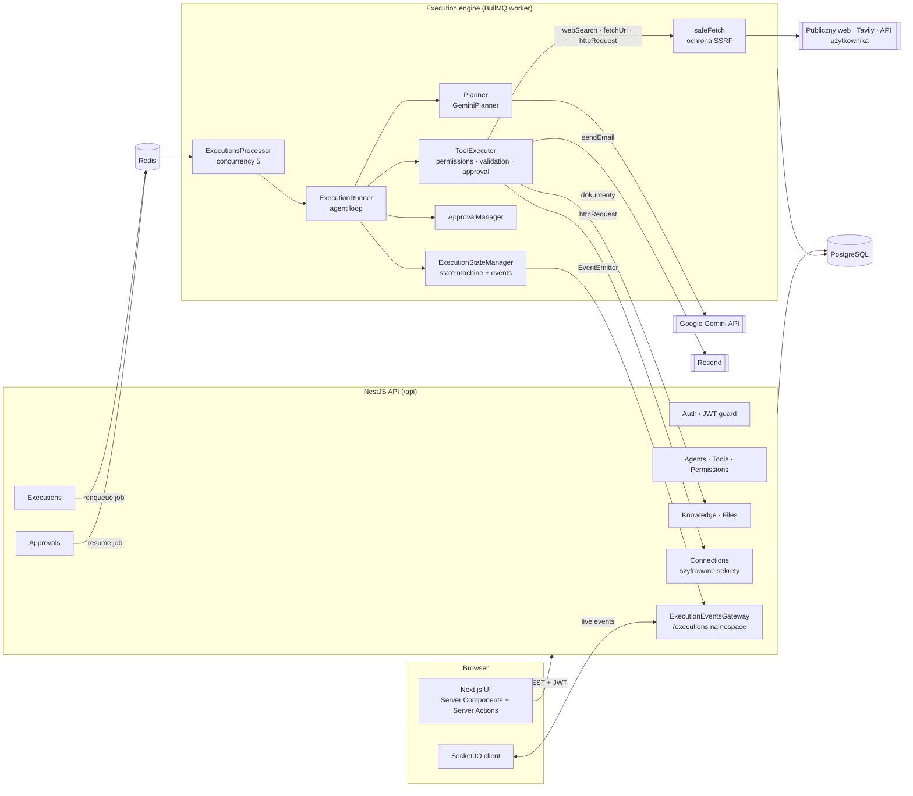
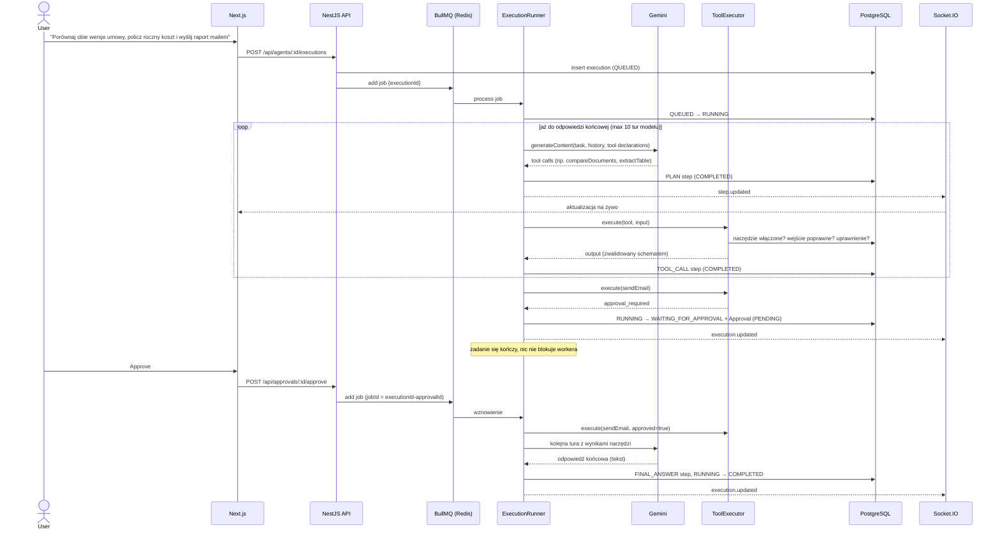
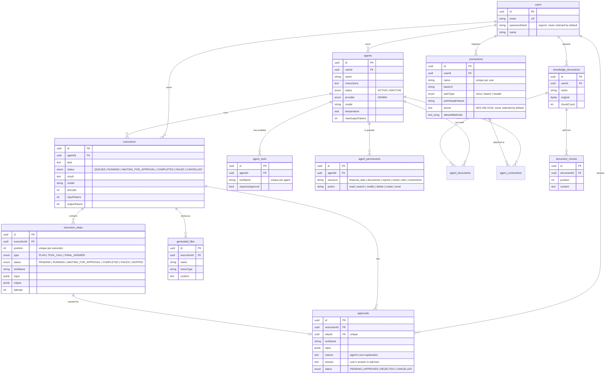

# AI Agent Platform

## Opis

AI Agent Platform to aplikacja full-stack w stylu SaaS do tworzenia agentów AI, nadawania im konkretnych narzędzi, wiedzy, połączeń z API i uprawnień oraz zlecania im wieloetapowych zadań. Agent planuje pracę przez function calling w Gemini i wykonuje narzędzia krok po kroku w workerze w tle. Potrafi czytać i porównywać dokumenty, wyciągać z nich tabele, liczyć, wyszukiwać i czytać strony w internecie, wywoływać podłączone API, generować raporty HTML z wykresami i wysyłać prawdziwe maile. Przed wrażliwymi akcjami zatrzymuje się i czeka na decyzję człowieka, w trakcie zadania może zadać użytkownikowi pytanie, a każdy krok trafia do UI na żywo. Każde wykonanie jest zapisywane i można je później przejrzeć.

To celowo **platforma wykonawcza, a nie chatbot**: model jest traktowany jako niezaufany komponent, a o tym, co faktycznie wolno mu zrobić, decyduje backend.

## Problem

Większość demo „agentów AI” to okno czatu z promptem. To się sypie, gdy agent ma wykonać prawdziwą pracę:

- **Bezpieczeństwo:** LLM może wywołać dowolne narzędzie, które widzi. Uprawnienia zapisane w prompcie nie są uprawnieniami. Gdy agent może pobierać strony i wołać API, da się go też nakłonić do sięgnięcia do usług wewnętrznych albo wycieku danych dostępowych.
- **Niezawodność:** wywołania modelu przekraczają timeout, trafiają na limity albo zwracają błędny format. Procesy padają w połowie zadania.
- **Widoczność:** użytkownik i developer nie wiedzą, co agent zrobił, dlaczego i ile to kosztowało.
- **Kontrola:** wrażliwe akcje (wysłanie maila, zapis do zewnętrznego API) wymagają decyzji człowieka, a wykonanie musi na nią poczekać, czasem godzinami. Przy niejasnym zadaniu agent powinien móc zapytać, zamiast zgadywać.

Platforma rozwiązuje to przez uprawnienia egzekwowane na backendzie, trwały i wznawialny silnik wykonawczy na kolejce zadań, akceptacje i pytania human-in-the-loop, ruch sieciowy chroniony przed SSRF z sekretami, których model nigdy nie widzi, oraz podgląd każdego kroku na żywo.

**Dla kogo:** dla developerów, którzy chcą widzieć każdy krok w szczegółach (wejście, wyjście, tokeny, ponowienia), oraz dla analityków i małych zespołów, którzy po prostu zlecają zadanie, akceptują akcje i czytają wynik.

## Kluczowe funkcje

- **Zarządzanie agentami:** tworzenie, edycja, duplikowanie (razem z narzędziami, uprawnieniami, wiedzą i połączeniami), aktywacja/dezaktywacja i usuwanie. Konfiguracja modelu, temperatury, limitu tokenów i instrukcji systemowych. Karty agentów pokazują aktywność na żywo: bezczynny albo pracuje, bieżący krok i ostatnie uruchomienie.
- **Rejestr narzędzi:** 11 typowanych narzędzi ze schematami Zod dla wejścia i wyjścia:
  - dokumenty: `readDocument`, `searchDocuments`, `extractTable` (tabele z CSV/TSV, JSON i Markdown z rozpoznawaniem kolumn liczbowych), `compareDocuments` (porównanie linia po linii ze wskaźnikiem podobieństwa);
  - analiza i wynik: `calculate` (bezpieczny kalkulator wyrażeń), `generateReport` (raport HTML z wykresami SVG słupkowymi i liniowymi), `sendEmail` (prawdziwy mail przez Resend, z wygenerowanym raportem w załączniku);
  - internet i API: `webSearch` (Tavily), `fetchUrl` (HTML/PDF/JSON do tekstu), `httpRequest` (wywołania połączeń z API zdefiniowanych przez użytkownika);
  - rozmowa: `askUser` (wstrzymuje wykonanie do czasu odpowiedzi użytkownika).
- **Uprawnienia per agent:** macierz zasób/akcja (`documents:read`, `web:search`, `connections:modify`, `email:send` …) sprawdzana przez backend przed każdym wywołaniem narzędzia. Uprawnienie może zależeć od wejścia: `GET` przez `httpRequest` wymaga `connections:read`, a `POST` wymaga `connections:modify` **i** akceptacji.
- **Połączenia z API:** użytkownik raz rejestruje zewnętrzne API (bazowy URL, dozwolone metody, autoryzacja tokenem Bearer albo nagłówkiem z kluczem) i przypina je do agentów. Sekrety są szyfrowane AES-256-GCM i dokładane do żądania przez backend, więc model nigdy ich nie widzi.
- **Human-in-the-loop:** narzędzie może wymagać akceptacji globalnie, dla konkretnego agenta albo w zależności od wejścia. Wykonanie się zatrzymuje, użytkownik widzi narzędzie, dane wejściowe i uzasadnienie agenta, po czym akceptuje albo odrzuca. `askUser` korzysta z tego samego mechanizmu: użytkownik wybiera podpowiedzianą odpowiedź, wpisuje własną albo pomija pytanie.
- **Autonomiczne planowanie:** agent sam decyduje, które narzędzia wywołać (równolegle, gdy to możliwe) i kiedy podać ostateczną odpowiedź.
- **UI wykonania na żywo:** aktualizacje kroków przez WebSockety (Socket.IO), bez ręcznego odświeżania strony.
- **Ponowienia i obsługa błędów:** rozróżnienie błędów, które warto ponowić, od trwałych, ponowienia z rosnącym opóźnieniem i widoczne próby („Attempt 2 / 3”). Nieudane wykonanie można uruchomić ponownie z poprawionym zadaniem.
- **Anulowanie:** anulowanie przerywa trwające wywołanie modelu przez `AbortSignal` i blokuje start kolejnych kroków.
- **Odporność na awarie:** gdy worker padnie w trakcie, BullMQ dostarcza zadanie ponownie, a silnik wznawia pracę z zapisanych kroków.
- **Baza wiedzy (prosty RAG):** wgrywanie plików `.pdf`, `.txt`, `.md`, `.csv` i `.json`, ekstrakcja tekstu, podział na fragmenty, przypinanie dokumentów do agentów i wyszukiwanie słów kluczowych. Oryginały można pobrać.
- **Pliki:** jedna strona z wgranymi dokumentami i plikami wygenerowanymi przez agentów (raporty), z filtrem źródła i pobieraniem przez uwierzytelnione proxy.
- **Obserwowalność:** metryki każdego wykonania: czas trwania, wywołania LLM i narzędzi, ponowienia, nieudane kroki, prośby o akceptację oraz tokeny wejściowe i wyjściowe.
- **Dashboard:** liczba agentów, dzisiejsze zadania, trwające wykonania, oczekujące akceptacje i ostatnie wykonania.

## Stack technologiczny

| Warstwa | Technologia | Dlaczego |
|---|---|---|
| Frontend | Next.js 16 (App Router), React 19, Tailwind v4 | Server Components i Server Actions trzymają JWT w ciasteczku httpOnly, więc przeglądarka nigdy nie dotyka tokena API |
| Realtime | Socket.IO (namespace `/executions`) | Pokój per wykonanie, handshake z JWT, proste reconnecty |
| Backend | NestJS 12 (ESM, TypeScript) | Moduły i DI dobrze odwzorowują domenę: agenci, narzędzia, silnik, akceptacje, wiedza, połączenia, web |
| ORM / DB | TypeORM + PostgreSQL | Model relacyjny, `jsonb` na wejście/wyjście kroków, zmiany wyłącznie przez migracje (`synchronize: false`) |
| Kolejka | BullMQ + Redis | Trwałe zadania, ponowne dostarczenie po awarii, kontrola współbieżności, idempotentne ID zadań |
| LLM | Google Gemini przez `@google/genai` | Natywny function calling. Abstrakcja `Planner` pozwala wymienić dostawcę |
| Walidacja | Zod (narzędzia), class-validator (DTO HTTP) | Jeden schemat Zod waliduje wejście i wyjście narzędzia **oraz** generuje JSON Schema wysyłany do Gemini |
| Integracje | Resend (mail), Tavily (wyszukiwanie), `unpdf`, `marked`, `diff` | Prawdziwe efekty uboczne za typowanymi narzędziami; ekstrakcja tekstu z PDF, raporty z Markdown, porównywanie dokumentów |
| Auth | JWT + argon2 | Bezstanowa autoryzacja API, plus osobny krótkożyjący token dla WebSocketów |
| Testy / lint | Vitest, oxlint, Prettier | Szybki runner testów i linter z natywnym wsparciem ESM |

## Architektura



**Warstwa API** tylko waliduje żądania, zapisuje stan i dodaje zadania do kolejki. Cała praca agenta odbywa się w **silniku**, który działa w workerze BullMQ. Silnik nigdy nie ufa modelowi: każde wywołanie narzędzia przechodzi przez `ToolExecutor`, który sprawdza, czy narzędzie jest włączone dla agenta, czy wejście pasuje do schematu, czy agent ma uprawnienie wymagane dla *tego* wejścia i czy potrzebna jest akceptacja. Każde wychodzące żądanie HTTP przechodzi przez `safeFetch`.

## Przepływ danych: zadanie z akceptacją



Stan wykonania żyje **w całości w bazie danych** jako uporządkowana lista kroków. Runner przy każdej turze odtwarza z nich rozmowę z modelem. Dzięki temu wstrzymane albo przerwane awarią wykonanie wznawia się dokładnie w miejscu, w którym stanęło. `askUser` przechodzi tą samą ścieżką: odpowiedź zapisuje się przy akceptacji i trafia do narzędzia po wznowieniu zadania.

## Schemat bazy danych



Schemat powstaje z 17 przyrostowych migracji TypeORM. Przejścia statusu wykonania pilnuje jawna maszyna stanów (`execution-status.ts`), a każdy zapis to warunkowy `UPDATE … WHERE status = <oczekiwany>`, więc dwa workery nigdy nie przesuną tego samego wykonania jednocześnie.

## Najważniejsze endpointy API

Wszystkie trasy są pod `/api` i wymagają JWT, chyba że oznaczono je jako publiczne.

| Metoda | Trasa | Cel |
|---|---|---|
| `POST` | `/auth/register`, `/auth/login` | Rejestracja i logowanie |
| `POST` | `/auth/socket-token` | Krótkożyjący (60 s) token do handshake'u WebSocket |
| `GET/POST/PATCH/DELETE` | `/agents`, `/agents/:id` | CRUD agentów |
| `POST` | `/agents/:id/duplicate` | Klonowanie agenta z konfiguracją |
| `PUT/DELETE` | `/agents/:agentId/tools/:toolName` | Włączenie lub wyłączenie narzędzia, opcjonalnie z akceptacją |
| `PUT` | `/agents/:agentId/permissions` | Podmiana zestawu uprawnień agenta |
| `PUT/DELETE` | `/agents/:agentId/knowledge/:documentId` | Przypięcie lub odpięcie dokumentu |
| `GET/POST/PATCH/DELETE` | `/connections`, `/connections/:id` | Połączenia z API (sekret tylko do zapisu) |
| `PUT/DELETE` | `/agents/:agentId/connections/:connectionId` | Przypięcie lub odpięcie połączenia |
| `POST` | `/agents/:agentId/executions` | Start zadania |
| `GET/DELETE` | `/executions/:id` | Wykonanie z krokami i wyliczonymi metrykami |
| `POST` | `/executions/:id/cancel` | Anulowanie trwającego wykonania |
| `POST` | `/approvals/:id/approve` (`{ answer? }`), `/approvals/:id/reject` | Decyzja albo odpowiedź człowieka, która wznawia wykonanie |
| `POST` | `/knowledge` | Upload dokumentu (multipart) |
| `GET` | `/files`, `/files/:id/download` | Pliki wygenerowane przez agentów |
| `GET` | `/dashboard` | Zagregowane statystyki dashboardu |
| `GET` | `/health` | Health check Postgresa i Redisa |

**Przykład: start zadania**

```http
POST /api/agents/3f1c…/executions
Authorization: Bearer <jwt>
Content-Type: application/json

{ "task": "Porównaj umowa-v1.md z umowa-v2.md, policz, o ile wzrosną nasze roczne koszty IT, i wyślij raport na accountant@company.com" }
```

```json
{
  "id": "9b2e…",
  "agentId": "3f1c…",
  "task": "Porównaj umowa-v1.md z umowa-v2.md, policz, o ile wzrosną nasze roczne koszty IT, i wyślij raport na accountant@company.com",
  "status": "QUEUED",
  "model": "gemini-2.5-flash",
  "llmCalls": 0,
  "inputTokens": 0,
  "outputTokens": 0,
  "createdAt": "2026-11-12T14:32:05.120Z"
}
```

**Zdarzenia WebSocket** (namespace `/executions`): klient wysyła `subscribe` z id wykonania, serwer sprawdza, czy wykonanie należy do użytkownika, i wypycha zdarzenia `execution.updated` oraz `step.updated`.

## Przykładowy przebieg

Agent demo to **Financial Analyst** z włączonymi narzędziami do dokumentów, `calculate`, `generateReport`, `askUser` i `sendEmail` oraz z uprawnieniami `documents:read`, `financial_data:read`, `reports:create` i `email:send`. W jego bazie wiedzy są arkusz kosztów (`koszty-2026.csv`) i dwie wersje umowy z dostawcą.

1. **Tworzenie agenta** z instrukcjami w stylu *„You are a financial analyst. Never invent financial information. If the task is ambiguous, ask the user…”*, potem wybór narzędzi, uprawnień i dokumentów. *(screen: agent-config.png)*
2. **Start zadania:** *„Dostawca IT przysłał nową umowę. Porównaj ją ze starą, policz, o ile wzrosną nasze roczne koszty IT, przygotuj raport i wyślij go na accountant@company.com.”*
3. **Tura 1:** Gemini równolegle wywołuje `compareDocuments` i `extractTable`. Diff pokazuje nową opłatę miesięczną, dłuższy okres umowy, dłuższe wypowiedzenie i nowy punkt o waloryzacji. Tabela wraca z kolumną kwot zamienioną na liczby (`"8 200,00 zł"` → `8200`).
4. **Tura 2:** model zauważa punkt o waloryzacji i wywołuje `askUser`: *„Czy raport ma uwzględniać waloryzację o inflację i jaką stopę przyjąć?”*. Wykonanie przechodzi w **WAITING_FOR_APPROVAL**, a karta pytania pokazuje podpowiedzi i pole na własną odpowiedź.
5. **Odpowiedź:** użytkownik wpisuje *„Tak, przyjmij 4%”*. Nowe zadanie w kolejce wznawia wykonanie, a narzędzie zwraca modelowi odpowiedź.
6. **Tura 3:** `calculate` liczy roczną różnicę (`(9100 − 8200) × 12 = 10 800 zł`, plus waloryzacja), a `generateReport` zapisuje raport HTML z wykresem słupkowym. Każdy krok pojawia się na osi czasu na żywo, z JSON-em wejścia i wyjścia. *(screen: execution-live.png)*
7. **Tura 4:** model wywołuje `sendEmail` z raportem w załączniku i uzasadnia dlaczego. Executor zwraca `approval_required`. Użytkownik widzi odbiorcę, temat, treść i uzasadnienie agenta, po czym klika *Approve*. *(screen: approval.png)*
8. **Wznowienie:** mail wychodzi przez Resend z kluczem idempotencji, model pisze odpowiedź końcową, a wykonanie kończy się jako **COMPLETED**.
9. **Podgląd:** panel metryk pokazuje czas, wywołania LLM, wywołania narzędzi, ponowienia i tokeny. *(screen: execution-metrics.png)*

Jeśli użytkownik kliknie *Reject*, krok dostaje status `SKIPPED`, model otrzymuje komunikat „The user rejected this action.” i dostosowuje odpowiedź. Pominięte pytanie każe modelowi kontynuować według własnej oceny i wypisać przyjęte założenie.

## Kluczowe decyzje i kompromisy

- **Kroki jako jedyne źródło prawdy.** Silnik nie trzyma stanu agenta w pamięci: rozmowa jest odtwarzana z `execution_steps` przy każdej turze. Kosztuje to dodatkowe zapytanie na turę, ale wznowienie po akceptacji, po pytaniu, po awarii i po anulowaniu przechodzi tą samą ścieżką kodu.
- **Czekanie na człowieka nie blokuje workera.** Zadanie kończy się, gdy potrzebna jest akceptacja albo odpowiedź, a wznawia je nowe zadanie z deterministycznym `jobId = executionId-approvalId`. Wykonanie może czekać godzinami bez żadnego kosztu.
- **Jeden mechanizm dla akceptacji i pytań.** `askUser` to narzędzie, które zawsze wymaga akceptacji, a akceptacja po prostu niesie odpowiedź użytkownika. Nie trzeba było dodawać nowego stanu wykonania, endpointu ani logiki wznawiania.
- **Uprawnienia egzekwowane w kodzie, nigdy w prompcie.** Zanim cokolwiek się wykona, `ToolExecutor` sprawdza kolejno: włączone narzędzie, wejście względem schematu Zod, uprawnienie resource:action dla tego wejścia i wymóg akceptacji.
- **Jeden schemat, trzy zastosowania.** Schemat Zod narzędzia waliduje wejście od modelu i wyjście narzędzia, a po konwersji do JSON Schema (target `openapi-3.0`) trafia do deklaracji funkcji w Gemini.
- **Błędy do ponowienia vs trwałe.** `ModelCallError` i `ToolExecutionError` mają flagę `retryable`. Błąd 429 z krótkim `retryDelay` jest ponawiany, przekroczony limit dzienny już nie. Nieudane wywołanie narzędzia **nie kończy wykonania**: model widzi błąd i może poprawić wejście.
- **Uniwersalne narzędzia zamiast mocków domenowych.** Pierwsza wersja miała mockowe narzędzia finansowe (`getTransactions`, `analyzeTransactions`). Zastąpiły je narzędzia działające na danych użytkownika: tabele wyciągane z dokumentów, `calculate` do dokładnych obliczeń (model nigdy nie liczy „w głowie”) i połączenia z prawdziwymi API.
- **Najpierw prosty RAG oparty na słowach kluczowych.** Podział tekstu (1000 znaków, zakładka 150, cięcie na granicach akapitów i zdań) plus scoring częstości słów za stabilnym interfejsem. Embeddingi można wstawić bez zmiany wywołań.

## Wyzwania i rozwiązania

- **Wznawianie rozmowy z modelem po pauzie.** Gemini wymaga, by jego poprzednia wiadomość (razem z *thought signatures*) wróciła w niezmienionej postaci. Rozwiązanie: surowy `Content` od dostawcy jest zapisywany w wyjściu kroku PLAN i odtwarzany dosłownie. Wyniki narzędzi z jednej tury wracają razem, jako jedna wiadomość `user` złożona z części `functionResponse`.
- **Dostęp agenta do sieci bez SSRF.** `fetchUrl` i `httpRequest` można by skierować na `localhost`, adres metadanych chmury albo sieć wewnętrzną. `safeFetch` przez własny `lookup` DNS sprawdza każdy rozwiązany adres IP (a nie tylko nazwę hosta) względem listy zablokowanych zakresów: prywatnych, loopback, link-local i zarezerwowanych, więc DNS rebinding nic nie daje. Sprawdza też ponownie każde przekierowanie, pilnuje timeoutu i limitu rozmiaru odpowiedzi oraz odrzuca dane logowania w URL-u.
- **Wywoływanie API użytkownika bez ujawniania sekretów.** Model podaje tylko nazwę połączenia i ścieżkę. Backend ustala bazowy URL, odrzuca ścieżki, które z niego wychodzą (`..`, zakodowane segmenty kropek, backslashe, znaki sterujące), sprawdza dozwolone metody, odszyfrowuje sekret i dokłada nagłówek autoryzacji. Metody zapisu wymagają osobnego uprawnienia i zawsze akceptacji.
- **Bezpieczne obliczenia.** `calculate` używa małego parsera rekurencyjnego z białą listą funkcji (`sum`, `avg`, `pct_change`, `cagr` …) zamiast `eval` i blokuje nazwy z prototypu, np. `constructor`.
- **Wyścigi między anulowaniem, akceptacją i workerem.** Każda zmiana statusu to warunkowy update (`WHERE id = ? AND status = ?`) sprawdzany względem tabeli dozwolonych przejść. Runner sprawdza `isStillRunning` przed każdym krokiem i po każdym opóźnieniu ponowienia, więc anulowanie zawsze wygrywa i nigdy nie zostaje nadpisane.
- **Awaria workera w trakcie wykonania.** Gdy BullMQ ponownie dostarcza zadanie dla wykonania wciąż oznaczonego jako `RUNNING`, runner oznacza przerwane kroki jako nieudane i pozwala modelowi zdecydować, co dalej, zamiast ślepo powtarzać efekty uboczne. Maile mają klucz idempotencji, więc ponowione wysłanie nie dociera dwa razy.
- **Prompt injection przez wynik narzędzia.** Strony internetowe i odpowiedzi API są traktowane jako dane. A ponieważ wrażliwe narzędzia wymagają zarówno uprawnienia, jak i akceptacji, złośliwa strona nie zmusi agenta do samodzielnego wysłania maila ani zapisu do API.
- **Aktualizacje na żywo bez wycieku danych.** Klienci WebSocket uwierzytelniają się osobnym, 60-sekundowym tokenem, a `subscribe` sprawdza, czy wykonanie należy do użytkownika, zanim dołączy go do pokoju.

## Testy i jakość

- **Testy jednostkowe (Vitest, 141 testów):** `ToolExecutor` (włączenie narzędzia, walidacja, uprawnienia i akceptacje zależne od wejścia), ochrona SSRF i konwersja HTML do tekstu, walidacja ścieżek połączeń i szyfrowanie sekretów, kalkulator wyrażeń, parsowanie tabel i formatów liczb, porównywanie dokumentów, renderowanie raportów, metryki wykonania, aktywność agentów, anulowanie, chunking i wyszukiwanie w bazie wiedzy.
- **Linting i formatowanie:** oxlint i Prettier na backendzie, ESLint na frontendzie.
- **Ścisły TypeScript** w obu aplikacjach i walidacja DTO (`whitelist`, `forbidNonWhitelisted`) dla każdego żądania HTTP.
- <!-- TODO: dodać CI (GitHub Actions) i testy e2e, jeśli/gdy powstaną -->

## Bezpieczeństwo

- Hasła hashowane **argon2**; `passwordHash` jest wykluczony z zapytań i serializacji.
- **Guard JWT** domyślnie na każdej trasie, z wyłączeniem przez `@Public()` dla endpointów auth.
- Frontend trzyma token w **ciasteczku httpOnly z sameSite=lax**, a wywołania API idą po stronie serwera w Server Actions.
- **Izolacja danych:** każde zapytanie filtruje po `userId`, a narzędzia dostają `ToolContext` ograniczony do jednego agenta, więc narzędzie nie odczyta dokumentów innego agenta ani nie użyje jego połączeń.
- **Uprawnienia do narzędzi i akceptacje egzekwowane na backendzie**; LLM jest traktowany jako niezaufany.
- **Ochrona przed SSRF** dla każdego wychodzącego żądania, ze sprawdzaniem IP po rozwiązaniu DNS i przy przekierowaniach.
- **Sekrety połączeń** szyfrowane w bazie (AES-256-GCM), w API tylko do zapisu i nigdy nie wysyłane do modelu.
- Generowane raporty HTML mają restrykcyjny **Content-Security-Policy** (bez skryptów, tylko style inline i obrazy `data:`), a Markdown jest renderowany z escapowaniem HTML.
- Brak wykonywania dowolnego kodu: narzędzia to stały, typowany rejestr.

## Uruchomienie lokalne

Wymagania: Node.js, PostgreSQL i Redis.

```bash
# backend
cd backend
cp .env.example .env          # ustaw DATABASE_URL, REDIS_URL, JWT_SECRET, GEMINI_API_KEY,
                              # ENCRYPTION_KEY, RESEND_API_KEY, EMAIL_FROM
                              # opcjonalnie: TAVILY_API_KEY (wyszukiwanie w sieci)
npm install
npm run migration:run
npm run start:dev             # http://localhost:3001/api

# frontend
cd ../frontend
npm install
npm run dev                   # http://localhost:3000
```

Przykładowe pliki do testowania narzędzi dokumentowych są w `demo-data/`.

<!-- TODO: dodać docker-compose dla Postgres + Redis, żeby uruchamiać jedną komendą -->

## Ograniczenia i plany

- Wyszukiwanie w bazie wiedzy opiera się na słowach kluczowych. Następny krok: embeddingi + pgvector.
- `extractTable` nie wykrywa tabel w PDF-ach, bo ekstrakcja tekstu gubi układ strony.
- Pytania z `askUser` korzystają ze statusu `WAITING_FOR_APPROVAL` zamiast osobnego stanu „czeka na odpowiedź”.
- Na razie obsługiwany jest tylko Gemini; interfejs `Planner` jest gotowy na kolejnych dostawców.
- W planach: eksport do arkusza kalkulacyjnego, szablony agentów, wersjonowanie instrukcji, wykonania według harmonogramu, MCP i własne narzędzia, limity kosztów i zapytań, przestrzenie zespołowe.

## Czego się nauczyłem

- Projektowania **wznawialnej pętli agenta**, w której cały stan jest trwały, zamiast trzymania rozmowy w pamięci.
- Budowania **maszyny stanów z optymistyczną współbieżnością**, która działa poprawnie przy równoległych workerach, anulowaniach i akceptacjach.
- Praktycznej pracy z **function callingiem LLM**: równoległe wywołania narzędzi, thought signatures, błędnie sformatowane wywołania, obsługa limitów.
- Traktowania modelu jako **niezaufanego aktora** i stawiania granicy bezpieczeństwa na backendzie, także w sieci: SSRF, path traversal i sekrety, których model nie może zobaczyć.
- Projektowania **narzędzi dla LLM**: precyzyjne opisy, małe schematy wejścia, błędy, z których model potrafi wyjść, i deterministyczne helpery do rzeczy, w których modele są słabe (arytmetyka, porównywanie tekstów, parsowanie tabel).
- Spinania **BullMQ + Socket.IO + Next.js Server Components** w UI na żywo bez odpytywania serwera po stronie klienta.
